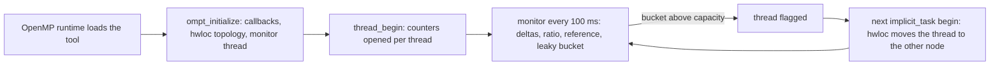
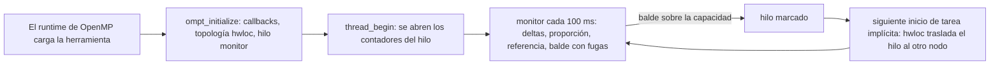

# Scheduler Internals · Funcionamiento interno del scheduler

[English](#english) · [Español](#español)

Source: [`src/sched_NUMA_optC_leaky.cpp`](../src/sched_NUMA_optC_leaky.cpp). Thesis:
Section 2.3 (Equations 2.1–2.6, Tables 2.3 and 2.4).

---

## English

### 1. Purpose

The scheduler is an OMPT tool (OpenMP Tools Interface) that observes, while the
application runs, which fraction of the cache lines each OpenMP thread receives from
the **other** NUMA node, and moves a thread to the opposite node when that fraction
stays high relative to the rest of the team. It needs no change to the application's
source code: it is a shared library that the OpenMP runtime loads through
`OMP_TOOL_LIBRARIES`.

### 2. Architecture

The tool has four parts:

| Part | Role | Main functions |
|---|---|---|
| OMPT layer | Registers callbacks and follows the life cycle of every thread | `ompt_start_tool`, `ompt_initialize`, `on_ompt_callback_*` |
| Hardware monitoring | Opens per-thread counters with `perf_event_open` and reads them | `open_perf_for_thread`, `read_counter`, `read_fills` |
| Decision engine | A monitor thread that every 100 ms computes the remote ratio and decides | `monitor_loop` |
| Migration engine | Moves the flagged thread to the opposite node with hwloc | `on_ompt_callback_implicit_task` |



### 3. Execution flow

1. The runtime calls `ompt_start_tool`, which returns `ompt_initialize` and
   `ompt_finalize`.
2. `ompt_initialize` reads the environment (`OMPT_*`), opens the output CSVs, loads the
   hwloc topology, registers six callbacks (`thread_begin`, `thread_end`,
   `parallel_begin`, `parallel_end`, `implicit_task`, `control_tool`) and starts the
   monitor thread.
3. `thread_begin` adds the thread to the thread table and opens its counters.
4. The kernel calls `omp_control_tool(omp_control_tool_start)` right before the measured
   loop and `omp_control_tool_pause` right after it; the tool only counts in between.
   Initialization, warm-up and validation are therefore excluded.
5. The monitor thread wakes up every `MONITOR_MS` = 100 ms and evaluates every thread
   that is alive, measuring and not being migrated.
6. At every `implicit_task` begin (the start of a parallel region for that thread) the
   thread refreshes its CPU and node and, if it was flagged, migrates.
7. `ompt_finalize` stops the monitor, freezes the totals and writes the per-thread
   summary, the per-window trace and the overhead record.

### 4. NUMA topology

At start-up the tool loads the topology with hwloc, enumerates the NUMA nodes and keeps
one CPU set per node. `cpu_to_numa_node_hwloc` maps the CPU a thread is running on
(`sched_getcpu`) to its node. The prototype handles two NUMA nodes
(`MAX_NUMA_NODES = 2`), which matches the evaluated platform (one node per socket).

### 5. Thread table

Each thread has a `ThreadInfo` entry with its Linux id (`gettid`), its OMPT id, its type,
its last CPU and node, its counter descriptors and last readings, its bucket, the number
of valid windows, the pending-migration and migrating flags, and its migration counters.
The lookup only matches **alive** entries, so a new thread that reuses a recycled Linux
id does not inherit the state of a finished one.

### 6. Hardware counters

Counters are opened per thread (not per CPU), so the counts follow the thread when it
changes core. They are opened in three groups:

| Group | Events | Use |
|---|---|---|
| Fill pair | `0xFF44` (all fills to L1d, leader) and `0xD044` (fills served by the other node) | **Decision variable** |
| Cycles | `PERF_COUNT_HW_CPU_CYCLES` (leader) and `PERF_COUNT_HW_INSTRUCTIONS` | Recorded (IPC), not used to decide |
| Per-origin breakdown | Masks `0x40` (far DRAM), `0x10` (far cache), `0x04` (neighbour CCD) of event `0x44` | Informative only |

`0x44` is `ls_any_fills_from_sys` of AMD Zen 4: demand and prefetch fills, classified
by the source that served the line. The pair is always in its own group, so both
counters cover the same interval and their quotient is consistent. Each counter is read
with `PERF_FORMAT_TOTAL_TIME_ENABLED | PERF_FORMAT_TOTAL_TIME_RUNNING` and rescaled when
the kernel multiplexes the groups; within the pair the scale factor cancels out.

Opening degrades by group instead of all-or-nothing:

| `perf_status` | Meaning |
|---|---|
| `full` | Cycles, instructions and the fill pair opened: the thread can be flagged |
| `ipc_only` | The fill pair did not open: the thread records IPC but never migrates |
| `failed` | Cycles or instructions did not open: the thread is not monitored |

Three breakdown masks are opened by default (`PERF_MAX_ORIGENES` changes that number and
`OMPT_MASCARAS=0` disables the breakdown). Zen 4 has six programmable counters and the
NMI watchdog takes one, so the seven events do not fit at once: the kernel multiplexes the
groups in time, and the rescaling above keeps each reading representative of the whole
interval.

### 7. Measurement windows

In every window the monitor makes two passes under the global lock:

1. **Read.** For each eligible thread it reads the counters and computes the deltas
   against the previous window. The first reading only sets the baseline. If any counter
   goes backwards, the window is dropped for that thread and the reading becomes the new
   baseline. The ratio is `ratio = Δrm / Δall`; it is `-1` when it cannot be measured.
   A window is **valid** only if `Δall ≥ MIN_FILLS` (10 000).
2. **Evaluate.** All valid threads are compared against the same threshold, computed once
   per window (Section 9), so the verdict does not depend on the order of the table.

### 8. Adaptive reference (Eq. 2.1–2.3)

Over the `N` valid threads of window `w`:

```
ρ_w  = Σ Δrm_i / Σ Δall_i                      aggregate remote ratio of the window
M_w  = (1/N) Σ | ratio_i,w − ref_(w−1) |        mean absolute deviation from the reference
ref_w = ref_(w−1) + β (ρ_w − ref_(w−1))         β = REF_BETA = 0.05
dev_w = dev_(w−1) + β (M_w − dev_(w−1))
```

In the first window with data the state is seeded directly: `ref = ρ` and `dev = M`
computed against that `ρ`. The reference is updated **after** evaluating the window, so
each window is judged with the state inherited from the previous one.

### 9. Shared threshold (Eq. 2.4)

```
dev^ = max(dev_(w−1), DEV_FLOOR)                DEV_FLOOR = 0.005
T_w  = ref_(w−1) + k_T · dev^                   k_T = LEAK_MARGIN_SIG = 1.0
```

The floor keeps the threshold, the leak and the capacity from collapsing when the team
is almost homogeneous. Every thread is compared against the same `T_w`: the question is
whether a thread departs from the collective behaviour of the team, not from its own
history.

### 10. Leaky bucket (Eq. 2.5)

```
B_i,w = B_i,(w−1) + (ratio_i,w − T_w)           if ratio_i,w >  T_w
B_i,w = max(0, B_i,(w−1) − k_L · dev^)          if ratio_i,w <= T_w      k_L = LEAK_RATE_SIG = 0.5
```

The bucket accumulates evidence: it fills by the excess over the threshold and drains
slowly otherwise. An isolated spike adds a little and leaks away; a sustained elevation
accumulates.

### 11. Flagging condition (Eq. 2.6)

A thread is flagged for migration when **all** of these hold:

- `B_i,w > cap_w = k_C · dev^`, with `k_C = LEAK_CAP_SIG = 8.0`;
- it has at least `WARMUP_WINDOWS` = 5 valid windows (at least 500 ms of observation);
- it has fewer than `MAX_MIGRATIONS` = 1 migrations;
- it has no pending flag and is not being migrated;
- migration is enabled (`OMPT_DISABLE_MIGRATION` unset).

The monitor never moves a thread: it only sets `needs_migration`.

### 12. Migration (Section 2.3.4)

The flagged thread migrates itself the next time it begins an implicit task, i.e. when it
enters a new parallel region, in three steps:

1. **Under the lock:** it refreshes its CPU and node, clears the pending flag and, if the
   topology is valid, migration is enabled, the node is known and the limit has not been
   reached, marks itself as `migrating` (the monitor then skips it).
2. **Without the lock:** `hwloc_set_thread_cpubind` binds it to the CPU set of the
   **opposite** node with `HWLOC_CPUBIND_THREAD | HWLOC_CPUBIND_STRICT` (retrying without
   `STRICT` if the kernel refuses). The system call runs outside the lock so the rest of
   the team does not wait for it.
3. **Under the lock:** on success it updates the node, increments `migrations`, records
   the window of the first migration, invalidates the counter baseline and empties its
   bucket; on failure it increments `mig_failures`. In both cases it clears `migrating`.

The destination is always the opposite node because, on two nodes, remote fills can only
come from the other one. The thread is bound to the whole node, not to a core, so the
operating system can still spread threads across that node's CCDs. From then on the
thread stays on that node; threads that did not migrate remain unbound.

### 13. Stability

There is no cool-down window: each thread can migrate **at most once** per execution
(`MAX_MIGRATIONS = 1`, checked both when flagging and when migrating). This prevents, by
construction, a thread from bouncing between the two nodes.

### 14. Cost of the instrument

The callbacks only do simple stores under a light spinlock and never allocate memory. The
per-window trace is kept in a pre-allocated buffer (`MAX_WINDOW_ROWS` = 262 144 rows) and
written only in `ompt_finalize`, so there is no I/O on the hot path. The tool measures
itself: time inside the callbacks, time of each monitor tick and time spent migrating go
to `ompt_overhead.csv` (thesis, Section 3.6 and Table 3.4).

### 15. Parameters (Table 2.4)

| Symbol | Constant | Value | Meaning |
|---|---|---|---|
| Δt | `MONITOR_MS` | 100 ms | Window length |
| F_min | `MIN_FILLS` | 10 000 | Minimum fills of a thread for a valid window |
| W_min | `WARMUP_WINDOWS` | 5 | Valid windows before a thread can be flagged |
| β | `REF_BETA` | 0.05 | EWMA smoothing of `ref` and `dev` |
| dev_min | `DEV_FLOOR` | 0.005 | Floor of the dispersion |
| k_T | `LEAK_MARGIN_SIG` | 1.0 | Threshold margin, in dispersion units |
| k_L | `LEAK_RATE_SIG` | 0.5 | Leak per window without excess |
| k_C | `LEAK_CAP_SIG` | 8.0 | Bucket capacity that flags the thread |
| M_max | `MAX_MIGRATIONS` | 1 | Migrations per thread per execution |

The constants are compile-time values at the top of the source file. The policy
constants (β, dev_min, k_T, k_L, k_C) were tuned empirically on test runs of SpMV that
are not part of the reported campaign; no sensitivity analysis was made.

### 16. Function reference

| Function | Role |
|---|---|
| `ompt_start_tool` | Entry point called by the OpenMP runtime |
| `ompt_initialize` / `ompt_finalize` | Set-up and tear-down of the whole tool |
| `monitor_loop` | Monitor thread: reading, reference, threshold, bucket, flagging |
| `open_perf_for_thread`, `open_counter` | Open the three counter groups of a thread |
| `read_counter`, `read_fills` | Read (and rescale) the counters |
| `enable_perf`, `disable_perf`, `close_perf` | Counter life cycle |
| `upsert_thread` | Insert or refresh an entry of the thread table |
| `cpu_to_numa_node_hwloc` | CPU → NUMA node |
| `on_ompt_callback_thread_begin` / `_end` | Register a thread and open / freeze its counters |
| `on_ompt_callback_control_tool` | Start and pause of the measured region |
| `on_ompt_callback_implicit_task` | Refresh placement and apply a pending migration |
| `flush_window_csv`, `write_overhead_csv` | Write the outputs at the end |

### 17. Outputs

`OMPT_WINDOW_CSV` (one row per thread and window, with the decision variables
`ratio_rm`, `bucket`, `thr_T`, `g_ref`, `g_dev` and `flagged`), `OMPT_SUMMARY_CSV` (one
row per thread) and `OMPT_OVERHEAD_CSV` (one row per run). Columns are described in
[data-guide.md](data-guide.md).

### 18. Scope and limits

The prototype assumes two NUMA nodes and always moves a thread to the opposite one; the
events used tell whether a line came from another node, not from which one. Each thread
migrates at most once. A thread can only be flagged after 500 ms of observation, so the
mechanism cannot act on executions whose measured region is shorter. The callbacks
update the shared state under one global lock, which makes the cost of the instrument
grow with the number of threads. The thesis discusses these points in Chapter 4.

---

## Español

### 1. Propósito

El scheduler es una herramienta OMPT (OpenMP Tools Interface) que observa, mientras la
aplicación se ejecuta, qué fracción de las líneas de caché recibe cada hilo de OpenMP
desde el **otro** nodo NUMA, y traslada un hilo al nodo opuesto cuando esa fracción se
mantiene alta respecto al resto del equipo. No requiere cambios en el código fuente de la
aplicación: es una biblioteca compartida que el runtime de OpenMP carga mediante
`OMP_TOOL_LIBRARIES`.

### 2. Arquitectura

La herramienta tiene cuatro partes:

| Parte | Función | Funciones principales |
|---|---|---|
| Capa OMPT | Registra los *callbacks* y sigue el ciclo de vida de cada hilo | `ompt_start_tool`, `ompt_initialize`, `on_ompt_callback_*` |
| Monitorización de hardware | Abre contadores por hilo con `perf_event_open` y los lee | `open_perf_for_thread`, `read_counter`, `read_fills` |
| Motor de decisión | Un hilo monitor que cada 100 ms calcula la proporción remota y decide | `monitor_loop` |
| Motor de migración | Traslada el hilo marcado al nodo opuesto con hwloc | `on_ompt_callback_implicit_task` |



### 3. Flujo de ejecución

1. El runtime llama a `ompt_start_tool`, que devuelve `ompt_initialize` y
   `ompt_finalize`.
2. `ompt_initialize` lee el entorno (`OMPT_*`), abre los CSV de salida, carga la
   topología con hwloc, registra seis *callbacks* (`thread_begin`, `thread_end`,
   `parallel_begin`, `parallel_end`, `implicit_task`, `control_tool`) y arranca el hilo
   monitor.
3. `thread_begin` añade el hilo a la tabla de hilos y abre sus contadores.
4. El kernel llama a `omp_control_tool(omp_control_tool_start)` justo antes del bucle
   medido y a `omp_control_tool_pause` justo después; la herramienta solo cuenta entre
   ambas llamadas, así que la inicialización, el calentamiento y la validación quedan
   excluidos.
5. El hilo monitor despierta cada `MONITOR_MS` = 100 ms y evalúa cada hilo vivo, en
   medición y que no esté siendo migrado.
6. Al comenzar cada tarea implícita (el inicio de una región paralela para ese hilo), el
   hilo actualiza su CPU y su nodo y, si estaba marcado, migra.
7. `ompt_finalize` detiene el monitor, congela los totales y escribe el resumen por hilo,
   la traza por ventana y el registro de costo.

### 4. Topología NUMA

Al arrancar, la herramienta carga la topología con hwloc, enumera los nodos NUMA y
guarda un conjunto de CPU por nodo. `cpu_to_numa_node_hwloc` traduce la CPU en la que se
ejecuta un hilo (`sched_getcpu`) a su nodo. El prototipo gestiona dos nodos NUMA
(`MAX_NUMA_NODES = 2`), que corresponde a la plataforma evaluada (un nodo por socket).

### 5. Tabla de hilos

Cada hilo tiene una entrada `ThreadInfo` con su identificador de Linux (`gettid`), su
identificador OMPT, su tipo, su última CPU y nodo, los descriptores y últimas lecturas de
sus contadores, su balde, el número de ventanas válidas, las banderas de migración
pendiente y en curso, y sus contadores de migraciones. La búsqueda solo empareja entradas
**vivas**, de modo que un hilo nuevo que reutilice un identificador de Linux reciclado no
hereda el estado de uno ya terminado.

### 6. Contadores de hardware

Los contadores se abren por hilo (no por CPU), así que el conteo acompaña al hilo cuando
cambia de núcleo. Se abren en tres grupos:

| Grupo | Eventos | Uso |
|---|---|---|
| Par de rellenos | `0xFF44` (todos los rellenos de la L1d, líder) y `0xD044` (rellenos servidos por el otro nodo) | **Variable de decisión** |
| Ciclos | `PERF_COUNT_HW_CPU_CYCLES` (líder) y `PERF_COUNT_HW_INSTRUCTIONS` | Se registran (IPC), no deciden |
| Desglose por origen | Máscaras `0x40` (DRAM lejana), `0x10` (caché lejana) y `0x04` (CCD vecino) del evento `0x44` | Solo informativo |

`0x44` es `ls_any_fills_from_sys` de AMD Zen 4: rellenos por demanda y por
prebúsqueda, clasificados según el origen que sirvió la línea. El par va siempre en su
propio grupo, así que los dos contadores cubren el mismo intervalo y su cociente es
consistente. Cada contador se lee con
`PERF_FORMAT_TOTAL_TIME_ENABLED | PERF_FORMAT_TOTAL_TIME_RUNNING` y se reescala cuando el
núcleo multiplexa los grupos; dentro del par, el factor de escala se cancela.

La apertura se degrada por grupo en lugar de todo o nada:

| `perf_status` | Significado |
|---|---|
| `full` | Se abrieron ciclos, instrucciones y el par de rellenos: el hilo puede ser marcado |
| `ipc_only` | El par de rellenos no se abrió: el hilo registra IPC pero nunca migra |
| `failed` | Ciclos o instrucciones no se abrieron: el hilo no se monitoriza |

Por defecto se abren tres máscaras del desglose (`PERF_MAX_ORIGENES` cambia ese número y
`OMPT_MASCARAS=0` desactiva el desglose). Zen 4 tiene seis contadores programables y el
NMI watchdog ocupa uno, así que los siete eventos no caben a la vez: el núcleo multiplexa
los grupos en el tiempo, y el reescalado anterior mantiene cada lectura representativa
del intervalo completo.

### 7. Ventanas de medición

En cada ventana el monitor hace dos pasadas bajo el bloqueo global:

1. **Lectura.** Para cada hilo elegible lee los contadores y calcula los incrementos
   respecto a la ventana anterior. La primera lectura solo fija la línea base. Si algún
   contador retrocede, la ventana se descarta para ese hilo y la lectura pasa a ser la
   nueva línea base. La proporción es `ratio = Δrm / Δall`; vale `-1` cuando no puede
   medirse. Una ventana es **válida** solo si `Δall ≥ MIN_FILLS` (10 000).
2. **Evaluación.** Todos los hilos válidos se comparan contra el mismo umbral, calculado
   una sola vez por ventana (sección 9), de modo que el veredicto no depende del orden
   de la tabla.

### 8. Referencia adaptativa (Ec. 2.1–2.3)

Sobre los `N` hilos válidos de la ventana `w`:

```
ρ_w  = Σ Δrm_i / Σ Δall_i                      proporción remota agregada de la ventana
M_w  = (1/N) Σ | ratio_i,w − ref_(w−1) |        desviación absoluta media respecto a la referencia
ref_w = ref_(w−1) + β (ρ_w − ref_(w−1))         β = REF_BETA = 0,05
dev_w = dev_(w−1) + β (M_w − dev_(w−1))
```

En la primera ventana con datos el estado se inicializa directamente: `ref = ρ` y
`dev = M` calculada respecto a ese `ρ`. La referencia se actualiza **después** de
evaluar la ventana, así que cada ventana se juzga con el estado heredado de la anterior.

### 9. Umbral compartido (Ec. 2.4)

```
dev^ = max(dev_(w−1), DEV_FLOOR)                DEV_FLOOR = 0,005
T_w  = ref_(w−1) + k_T · dev^                   k_T = LEAK_MARGIN_SIG = 1,0
```

El piso evita que el umbral, la fuga y la capacidad colapsen cuando el equipo es casi
homogéneo. Todos los hilos se comparan contra el mismo `T_w`: la pregunta es si un hilo
se aparta del comportamiento colectivo del equipo, no de su propio historial.

### 10. Balde con fugas (Ec. 2.5)

```
B_i,w = B_i,(w−1) + (ratio_i,w − T_w)           si ratio_i,w >  T_w
B_i,w = max(0, B_i,(w−1) − k_L · dev^)          si ratio_i,w <= T_w      k_L = LEAK_RATE_SIG = 0,5
```

El balde acumula evidencia: se llena con el exceso sobre el umbral y se vacía lentamente
en caso contrario. Un pico aislado aporta poco y se disipa; una elevación sostenida se
acumula.

### 11. Condición de marcado (Ec. 2.6)

Un hilo se marca para migrar cuando se cumplen **todas** estas condiciones:

- `B_i,w > cap_w = k_C · dev^`, con `k_C = LEAK_CAP_SIG = 8,0`;
- acumula al menos `WARMUP_WINDOWS` = 5 ventanas válidas (al menos 500 ms de
  observación);
- lleva menos de `MAX_MIGRATIONS` = 1 migraciones;
- no tiene una marca pendiente ni está siendo migrado;
- la migración está habilitada (`OMPT_DISABLE_MIGRATION` sin definir).

El monitor nunca traslada un hilo: solo activa `needs_migration`.

### 12. Migración (Sección 2.3.4)

El hilo marcado se traslada a sí mismo la siguiente vez que comienza una tarea
implícita, es decir, al entrar en una nueva región paralela, en tres pasos:

1. **Con el bloqueo:** actualiza su CPU y su nodo, limpia la marca pendiente y, si la
   topología es válida, la migración está habilitada, el nodo es conocido y no se ha
   alcanzado el límite, se marca como `migrating` (el monitor lo omite).
2. **Sin el bloqueo:** `hwloc_set_thread_cpubind` lo fija al conjunto de CPU del nodo
   **opuesto** con `HWLOC_CPUBIND_THREAD | HWLOC_CPUBIND_STRICT` (y reintenta sin
   `STRICT` si el núcleo lo rechaza). La llamada al sistema se hace fuera del bloqueo
   para que el resto del equipo no tenga que esperarla.
3. **Con el bloqueo:** si tuvo éxito, actualiza el nodo, incrementa `migrations`,
   registra la ventana de la primera migración, invalida la línea base de los
   contadores y vacía su balde; si falló, incrementa `mig_failures`. En ambos casos
   limpia `migrating`.

El destino es siempre el nodo opuesto porque, con dos nodos, los rellenos remotos solo
pueden venir del otro. El hilo se fija al nodo completo, no a un núcleo, para que el
sistema operativo pueda seguir repartiendo los hilos entre los CCD de ese nodo. A partir
de ahí el hilo permanece en ese nodo; los hilos que no migraron siguen sin fijar.

### 13. Estabilidad

No hay una ventana de enfriamiento: cada hilo puede migrar **como máximo una vez** por
ejecución (`MAX_MIGRATIONS = 1`, comprobado al marcar y al migrar). Esto impide, por
construcción, que un hilo oscile entre los dos nodos.

### 14. Costo del instrumento

Los *callbacks* solo hacen escrituras simples bajo un *spinlock* ligero y nunca reservan
memoria. La traza por ventana se guarda en un búfer reservado de antemano
(`MAX_WINDOW_ROWS` = 262 144 filas) y solo se escribe en `ompt_finalize`, así que no hay
entrada/salida en la ruta crítica. La herramienta se mide a sí misma: el tiempo dentro de
los *callbacks*, el de cada activación del monitor y el dedicado a migrar van a
`ompt_overhead.csv` (libro, Sección 3.6 y Tabla 3.4).

### 15. Parámetros (Tabla 2.4)

| Símbolo | Constante | Valor | Significado |
|---|---|---|---|
| Δt | `MONITOR_MS` | 100 ms | Duración de una ventana |
| F_min | `MIN_FILLS` | 10 000 | Mínimo de rellenos de un hilo para que la ventana sea válida |
| W_min | `WARMUP_WINDOWS` | 5 | Ventanas válidas antes de que un hilo pueda ser marcado |
| β | `REF_BETA` | 0,05 | Suavizado EWMA de `ref` y `dev` |
| dev_min | `DEV_FLOOR` | 0,005 | Piso de la dispersión |
| k_T | `LEAK_MARGIN_SIG` | 1,0 | Margen del umbral, en unidades de dispersión |
| k_L | `LEAK_RATE_SIG` | 0,5 | Fuga por ventana sin exceso |
| k_C | `LEAK_CAP_SIG` | 8,0 | Capacidad del balde que marca al hilo |
| M_max | `MAX_MIGRATIONS` | 1 | Migraciones por hilo y por ejecución |

Las constantes se fijan en compilación, al comienzo del archivo fuente. Las constantes de
la política (β, dev_min, k_T, k_L, k_C) se ajustaron empíricamente sobre ejecuciones de
prueba del SpMV que no forman parte de la campaña reportada; no se hizo un análisis de
sensibilidad.

### 16. Referencia de funciones

| Función | Papel |
|---|---|
| `ompt_start_tool` | Punto de entrada que invoca el runtime de OpenMP |
| `ompt_initialize` / `ompt_finalize` | Puesta en marcha y cierre de la herramienta |
| `monitor_loop` | Hilo monitor: lectura, referencia, umbral, balde y marcado |
| `open_perf_for_thread`, `open_counter` | Abren los tres grupos de contadores de un hilo |
| `read_counter`, `read_fills` | Leen (y reescalan) los contadores |
| `enable_perf`, `disable_perf`, `close_perf` | Ciclo de vida de los contadores |
| `upsert_thread` | Inserta o actualiza una entrada de la tabla de hilos |
| `cpu_to_numa_node_hwloc` | CPU → nodo NUMA |
| `on_ompt_callback_thread_begin` / `_end` | Registran un hilo y abren / congelan sus contadores |
| `on_ompt_callback_control_tool` | Inicio y pausa de la región medida |
| `on_ompt_callback_implicit_task` | Actualiza la ubicación y aplica una migración pendiente |
| `flush_window_csv`, `write_overhead_csv` | Escriben las salidas al final |

### 17. Salidas

`OMPT_WINDOW_CSV` (una fila por hilo y ventana, con las variables de decisión
`ratio_rm`, `bucket`, `thr_T`, `g_ref`, `g_dev` y `flagged`), `OMPT_SUMMARY_CSV` (una
fila por hilo) y `OMPT_OVERHEAD_CSV` (una fila por ejecución). Las columnas se describen
en [data-guide.md](data-guide.md).

### 18. Alcance y límites

El prototipo supone dos nodos NUMA y siempre traslada un hilo al opuesto; los eventos
empleados indican si una línea vino de otro nodo, pero no de cuál. Cada hilo migra como
máximo una vez. Un hilo solo puede marcarse tras 500 ms de observación, así que el
mecanismo no puede actuar en ejecuciones cuya región medida sea más corta. Los
*callbacks* actualizan el estado compartido bajo un único bloqueo global, lo que hace
crecer el costo del instrumento con el número de hilos. El libro discute estos puntos en
el Capítulo 4.
